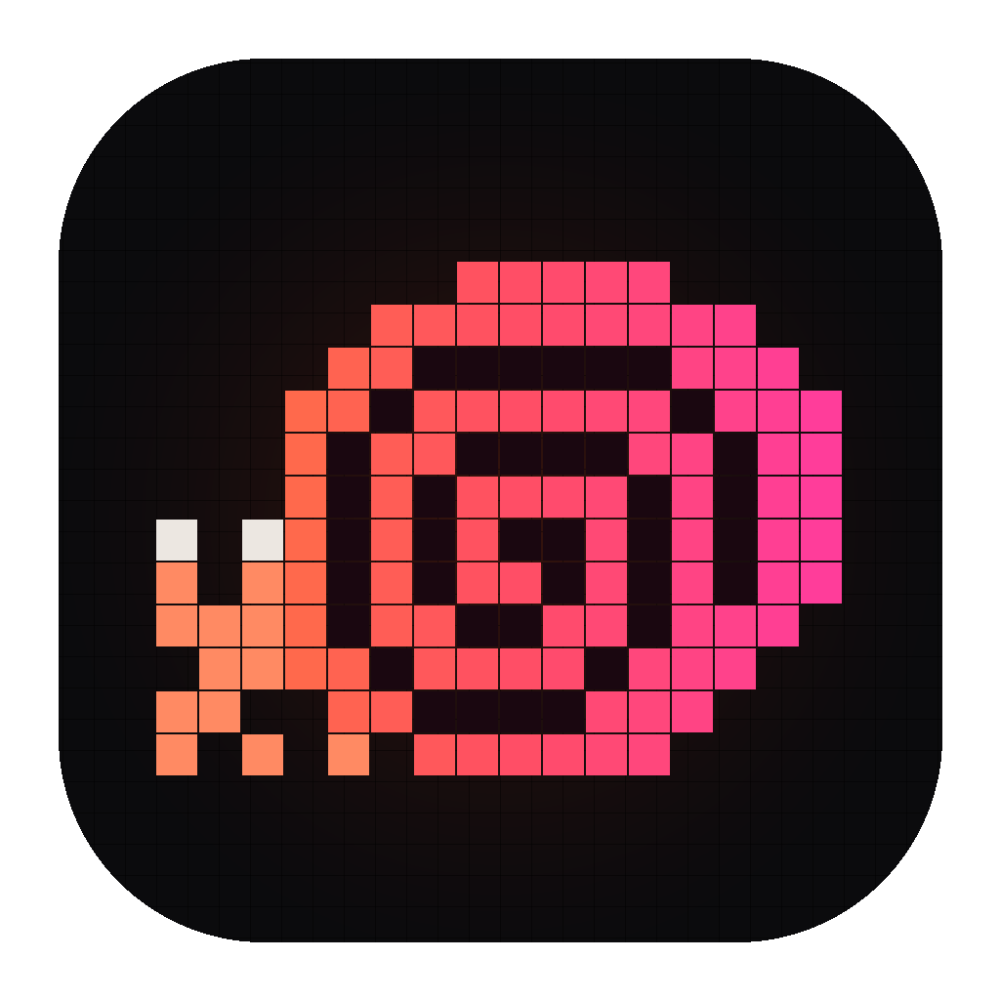

<p align="center">
  
</p>

<h1 align="center">PixelShell</h1>

<p align="center">
  Un éditeur de pixel art tout simple : sprites, tuiles et petites animations.<br>
  Gratuit, open source, sur macOS, Windows et Linux. Le petit frère de <a href="https://github.com/saturnes00/CrunshCrab">Crunch Crab</a>.
</p>
<p align="center"><b>Projet d'expérimentation étudiant, réalisé en partie avec l'aide de Claude Code.</b></p>

<p align="center">
  <a href="https://github.com/saturnes00/PixelShell/releases/latest"></a>
  <a href="https://github.com/saturnes00/PixelShell/actions/workflows/construire.yml"></a>
  
</p>

---

## Télécharger

| Système | Fichier | |
|---|---|---|
| **macOS** (Apple Silicon) | [PixelShell-macOS.zip](https://github.com/saturnes00/PixelShell/releases/latest/download/PixelShell-macOS.zip) | Dézippe, puis glisse l'app dans *Applications* |
| **Windows** 10 / 11 | [PixelShell-Windows.zip](https://github.com/saturnes00/PixelShell/releases/latest/download/PixelShell-Windows.zip) | Dézippe, puis lance `PixelShell.exe` |
| **Linux** (x86-64) | [PixelShell-Linux.tar.gz](https://github.com/saturnes00/PixelShell/releases/latest/download/PixelShell-Linux.tar.gz) | Décompresse, puis lance `./PixelShell` |

Rien d'autre à installer : Python et l'interface sont inclus.

<details>
<summary><b>Premier lancement : « l'app ne s'ouvre pas » ?</b></summary>

L'app n'est pas signée par Apple ni par Microsoft (c'est payant), donc le système se méfie au premier lancement. C'est normal.

- **macOS** : ouvre l'app une fois, puis va dans *Réglages Système → Confidentialité et sécurité* et clique sur **Ouvrir quand même**. Autre solution, dans le Terminal :
  ```bash
  xattr -dr com.apple.quarantine "/Applications/PixelShell.app"
  ```
- **Windows** : si SmartScreen affiche « Windows a protégé votre ordinateur », clique sur **Informations complémentaires → Exécuter quand même**.
- **Linux** : lance `./installer.sh` dans le dossier pour ajouter PixelShell au menu des applications. Sur une installation minimale, il peut manquer `libxcb-cursor0` (`sudo apt install libxcb-cursor0`).
</details>

## Aperçu

<p align="center">
  
</p>

## Ce qu'elle sait faire

- **9 outils** : sélection, crayon, gomme, pot de peinture, pipette, ligne, rectangle, ellipse, déplacer. Pinceau de 1 à 8 px, formes pleines ou en contour, Maj pour les angles droits, les carrés et les cercles
- **Symétrie** gauche / droite et haut / bas, avec les axes affichés
- **Sélection** : choisis une zone, puis déplace-la (Alt : en copie), copie, coupe, colle (aussi depuis ou vers une autre app), efface, retourne-la ou rogne la toile dessus
- **Grille adaptable** : de 1 × 1 à 2048 × 2048 (de quoi ouvrir une planche de sprites entière), tailles toutes prêtes (8, 16, 32, 64…, 320 × 240, 640 × 480), ancrage pour choisir de quel côté la toile grandit ou rétrécit, repères de tuiles tous les N pixels, **pixels carrés ou larges (2:1, façon Atari)**
- **10 palettes** (PICO-8, Sweetie 16, Endesga 32, Game Boy, Commodore 64, NES…), la palette tirée de ton dessin, ou la tienne. Modifier une couleur de la palette recolore le dessin
- **Animation** : plusieurs images, duplication, pelure d'oignon, lecture à la vitesse de ton choix
- **Import** : PNG, GIF animé, JPEG, BMP, WebP… Le pixel art garde sa taille réelle ; les photos peuvent être réduites en pixel art, puis tu peux les ramener à ta palette. Découpage d'une **planche de sprites**
- **Export** : PNG, planche de sprites, GIF animé, ou une image PNG par étape d'animation, agrandi jusqu'à ×32 sans aucun flou
- **Projet `.pxshell`** : garde tout (images, palette, grille, réglages). Et l'app reprend toujours là où tu l'as laissée
- Annuler / rétablir à l'infini (enfin, 200 fois), glisser-déposer, zoom au trackpad

## Raccourcis

| | macOS | Windows / Linux |
|---|---|---|
| Sélection · Crayon · Gomme · Pot · Pipette | S · B · E · F · I | S · B · E · F · I |
| Ligne · Rectangle · Ellipse · Déplacer | L · R · O · M | L · R · O · M |
| Prendre une couleur, avec n'importe quel outil | Alt + clic | Alt + clic |
| Peindre avec la couleur secondaire | clic droit | clic droit |
| Copier / couper / coller la sélection | ⌘C / ⌘X / ⌘V | Ctrl+C / X / V |
| Effacer la sélection · tout sélectionner · désélectionner | ⌫ · ⌘A · Échap | Suppr · Ctrl+A · Échap |
| Échanger les couleurs | X | X |
| Taille du pinceau | [ ] | [ ] |
| Grille | G | G |
| Image précédente / suivante · lire | , . · Entrée | , . · Entrée |
| Se déplacer | Espace + glisser, deux doigts | Espace + glisser, clic molette |
| Zoom | pincer, ⌘+ / ⌘− / ⌘0 | Ctrl + molette, Ctrl+ / Ctrl− / Ctrl+0 |
| Nouveau / ouvrir / enregistrer / exporter | ⌘N / ⌘O / ⌘S / ⌘E | Ctrl+N / O / S / E |
| Annuler / rétablir | ⌘Z / ⇧⌘Z | Ctrl+Z / Ctrl+Maj+Z |

Double-clic sur un réglage : il revient à sa valeur de départ.

## Lancer depuis le code source

Il faut Python 3.12 ou plus récent.

```bash
git clone https://github.com/saturnes00/PixelShell.git
cd PixelShell
python3 -m pip install -r requirements.txt
python3 app.py
```

Pour fabriquer l'app autonome : `pip install pyinstaller && python3 outils/icones.py && pyinstaller pixelshell.spec` (le résultat arrive dans `dist/`).
Sur macOS, `./creer_app.sh` crée aussi un raccourci dans *Applications* qui lance directement le code du dossier.

Pour vérifier que tout marche : `python3 app.py --auto-test dossier-de-test`.

## Comment c'est fait

La même architecture que Crunch Crab :

| Fichier | Rôle |
|---|---|
| `moteur.py` | Le cœur : outils de dessin (Bresenham pour les lignes, remplissage, ellipses…), palettes, redimensionnement, réduction des grandes images. Du [numpy](https://numpy.org) pur, sans interface : facile à tester. |
| `fichiers.py` | Import / export : PNG, GIF animé, planche de sprites, projet `.pxshell` (du JSON lisible avec les images en PNG dedans). |
| `app.py` | L'interface ([PySide6 / Qt](https://doc.qt.io/qtforpython-6/)) : la toile, la barre d'état, la fenêtre, l'historique. |
| `theme.py` | La direction artistique, partagée avec Crunch Crab : couleurs, dégradé, polices, feuille de style et icônes. |
| `composants.py` | Les éléments du panneau : curseurs en bargraphe, interrupteurs, sections, boîte à outils, nuancier, images de l'animation. |
| `pixelshell.spec` | La recette [PyInstaller](https://pyinstaller.org) pour fabriquer l'app. |
| `.github/workflows/` | GitHub construit et teste l'app sur les 3 systèmes à chaque mise à jour, puis publie les versions. |

Envie d'ajouter une palette ? Une ligne dans `PALETTES`, dans `moteur.py`, suffit :
```python
"Ma palette": ["#000000", "#ff0066", "#ffffff"],
```

## À propos du projet

PixelShell est un projet d'expérimentation, fait par un étudiant pour apprendre et pour dessiner les sprites de ses propres jeux.

Une partie du code a été écrite avec l'aide d'outils d'intelligence artificielle. Je préfère le dire clairement : l'app fonctionne et elle se teste toute seule sur les trois systèmes, mais ce n'est pas un logiciel professionnel. Il peut rester des bugs ou des choix techniques pas idéaux.

Les retours, signalements de bugs et suggestions sont les bienvenus dans les [Issues](https://github.com/saturnes00/PixelShell/issues) !

## Crédits

- Police des titres : [Silkscreen](https://github.com/googlefonts/silkscreen) de Jason Kottke, sous licence SIL Open Font License 1.1 (fournie dans `polices/`).
- Palettes : PICO-8 (Lexaloffle), [Sweetie 16](https://lospec.com/palette-list/sweetie-16) (GrafxKid), [Endesga 32](https://lospec.com/palette-list/endesga-32) (Endesga).

## Licence

[MIT](LICENSE) : tu peux utiliser, modifier et partager PixelShell librement.
